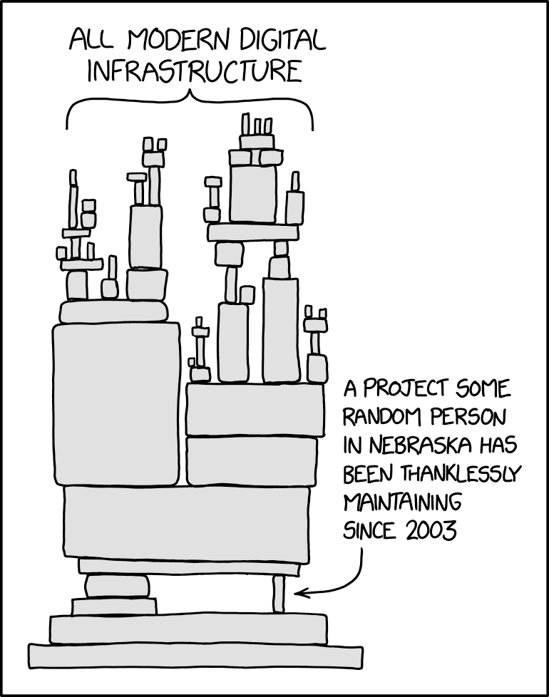
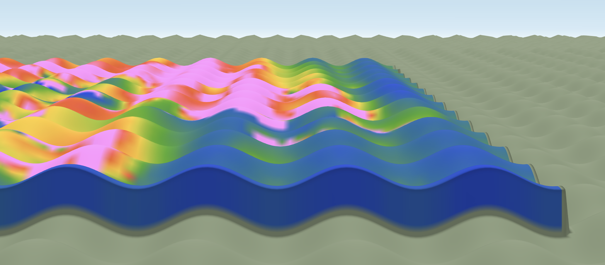
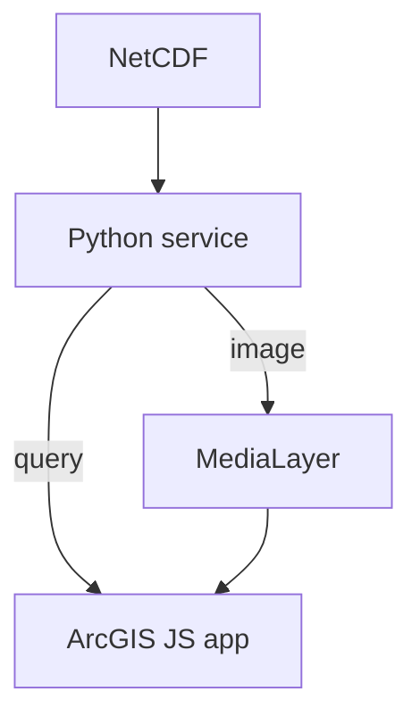
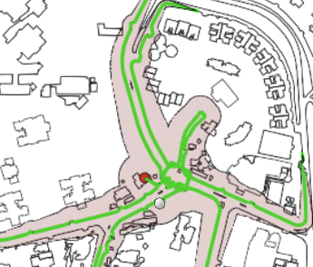

# Open Source in an Enterprise Ecosystem

Growing open-source capability alongside enterprise systems

Daniel Tan // FOSS4G NA 2026

---
layout: quote
---

# About me
Daniel

Human glue between 
1. Research Projects
1. Front end development  
1. Cloud deployments  
1. Enterprise GIS

---

# Four stories

1. Don't replace what works
1. Integrate with what already exists
1. Grow organisational comfort with examples & templates
1. Use case before tech

---
layout: section
---

# 1. Don't replace what works

---

# Case study: FME → Custom formats and scripts

A replacement for a working FME workflow.  

- FME workflows running on VMs in the cloud, slicing large STL files
- Process would OOM on high resolution inputs  
- I wrote a Rust/Python library which could do this in a Lambda function
- "Better": speed, stability, scalability, IaC deployments etc

---

# FME → Custom formats and scripts

Why it stalled

1. The existing team must be **confident** in the solution  
1. The team must be able to **maintain** it   
    - FME scripting is a skill they have
    - Rust and custom data formats are not
1. Leadership must see **value**
    - No new features means no visible difference  
    - Risk without reward

---
layout: section
---

# 2. Integrate with what exists
Extend instead of replacing

<!-- so i stopped replacing and began exending -->
---

# Fit into the existing web app

- We already have a web app built on the ArcGIS JS SDK
<!-- - Talking about formats is a **waste of time** if it can't be used -->
- Converting geojson to esri json
- Get creative about showing non-Esri data inside the Esri ecosystem

> NetCDF voxel data displayed as a .png image on modified terrain

---
layout: two-cols
layoutClass: gap-12
---

# Non-Esri data, Esri app
Querying NetCDF

Backend service reads the NetCDF file and answers queries from the app.  

Render output as an image draped on the map.  

Modify terrain to the correct elevation  

::right::

<!-- but this is really customised stuff, what about scaling up? -->

---
layout: section
---

# 3. Grow organisational comfort

Examples and templates

---

# A team that's comfortable

- Domain Specialists were happily using `shapely` and `geopandas` on Jupyter
- How can we deploy their work to reach more people?

- They want to focus on their domain problems
- No one really wants to deal with cloud infrastructure

---

# A paved road

- Standard `copier` template for a Python tool and its cloud deployment
- Standard **middleware stack** connecting frontend to backend tools
- New standard project scaffolded in **~20 minutes**

| Pattern | Solution |
| --- | --- |
| Short, simple tasks | Single Lambda function |
| Longer-running jobs | ECS task dispatch |
| Specialised runtimes | VM hosting a runtime |

Docker image building forces dependency list generation  
Saves me a bunch of compliance validation work

---
layout: section
---

# 4. Use case before tech

---
layout: two-cols
---

# Lead with the problem

- Focus on the **problem** and the **user benefit** 
<!-- what the problem is though, can be subject to interpretation -->
- I wrote a accessibility analysis tool in Rust 
- Compiled it to WebAssembly
- It had capabilities the current tools could not provide over the web
- However...

::right::

> calculating isochrones with Dijkstra's and buffering

<!-- 
I wrote a simplified accessibility analysis tool  
It gave results  
We couldn't figure out how to port Network Analyst to the browser
 -->

---
layout: quote
---

# No one wanted it 

<v-clicks>

- I was solving the wrong problem
- But the domain expert disagreed with my methodology
- Outputs did not match their existing tools
- Would this confuse users?

</v-clicks>

<!--
No one was **really** wrong here, but it stalled the project anyway  
But there was a upside to this stalled project!

-->

---
layout: section
---

# 5. Capability enables possibility
try, fail, redirect

---

# Same tech, new application
Hammer, meet Nail

<v-clicks>

- But now I knew how to build WebAssembly into the webapp
- So I am working on a specific feature request which is less subjective
- And that work for a different team is integrated into an upcoming feature

> I would not have the skill and knowledge needed to pull this off if not for that prior attempt

</v-clicks>

---

# What I've learned

1. **Don't replace** what works  
1. **Integrate** with what already exists  
1. **Templates** build comfort  
1. **Use case** before tech  
1. **Try stuff** and learn   

  
  
linkedin

 
 

> From the perspective of a developer, your mileage may vary  

<!-- under the hood all are OGC based, so it's not locked to one display ecosystem -->